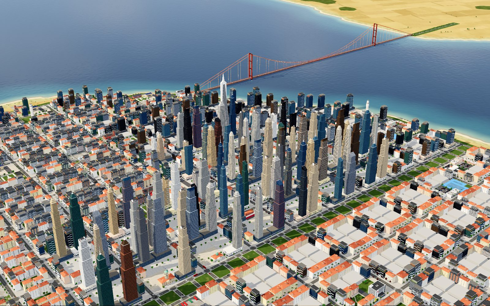
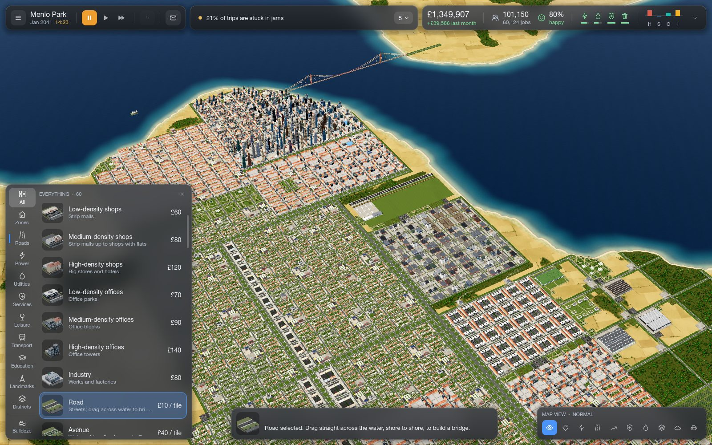

# Silicon City

A SimCity-style city builder on the real terrain of Menlo Park and the San Francisco Bay, with a Silicon Valley twist: big tech companies write to the mayor asking to build. Made in [Godot](https://godotengine.org) (free).

**Status:** a full game in 3D, still being played and tuned. See `CLAUDE.md` for progress and `GAME_DESIGN.md` for the design.

## What's in it

- **Zones that build themselves:** homes, shops, industry and offices in three densities, growing from Californian ranch houses and townhouses to skyscrapers in a CBD.
- **A town to run:** power and water networks, rubbish, police, fire, schools and hospitals, taxes, loans and happiness. Advisors tell you what's wrong.
- **Traffic:** roads, avenues and motorways. Drivers take the quickest way, and a Traffic view shows where the jams are. You can build bridges across the Bay.
- **Map views:** land value, power, water, services, pollution, traffic, districts and more.
- **The tech layer:**
  - Set up a Tech zone with its own tax rate.
  - Letters arrive from real companies (satire, names only) asking to build data centres, a Gigafactory, campuses, a launch site and a chip factory.
  - Back start-ups, and train tech workers at colleges, a university and a research park.
- **San Francisco's landmarks:** the Painted Ladies, Coit Tower, the Ferry Building, the Palace of Fine Arts, the Transamerica Pyramid, Salesforce Tower, the Golden Gate Bridge and Alcatraz.
- **Example cities** to load from the menu: Village, Town, City and Bay Area. Bay Area is San Francisco and Silicon Valley with about 100,000 people.
- **A built-in guide:** press H.

## Play it

1. Install **Godot 4.7** (free) from https://godotengine.org/download.
2. In Godot's Project Manager, choose **Import**, pick this folder's `project.godot`, then **Import & Edit**.
3. Press **Play** (▶, top right) or F5.
4. Pick a difficulty for a new city, or open ☰ → **Example cities** to look around a finished one.

### Controls

Build with the mouse: press, drag to see a preview and the cost, then let go to build.

| Keys | What they do |
| --- | --- |
| 1 | Roads |
| 2 / 3 / 4 | Homes, shops, industry (Tab changes density) |
| 9 | Street grid (drag a box) |
| 5 or B | Bulldoze |
| 6 / 7 | Power, utilities (Tab picks the next building) |
| 8 / - / = | Parks, leisure, transport |
| 0 | Services |
| Z | Paint districts |
| M | Show or hide the Build menu |
| Esc | Cancel a drag |
| Cmd/Ctrl + Z | Undo the last build |
| Space | Pause or play |
| F | Fast |
| O | Next map view |
| C | Services view, one service at a time |
| T | Cars and people on or off |
| H | The guide |
| W A S D, two-finger scroll, middle-drag | Move the camera |
| Q / E, right-drag | Turn and tilt |
| Scroll, pinch | Zoom |
| Cmd/Ctrl + S / L | Save / load |

## The map

The game loads `map/menlo_park_map.json`:

- **What it covers:** Menlo Park, East Palo Alto and the Bay with the Dumbarton crossing.
- **Size:** 180 × 160 tiles at 50 m a tile.
- **Heights:** USGS and NOAA data, from AWS's free Terrain Tiles.
- **How it's made:** `tools/make_bay_map.py`, which works for any place (`--centre`, `--size`).

The earlier Palo Alto map is still in `map/`.

## Tools for building the game

| Command | What it does |
| --- | --- |
| `tools/screenshots.sh` | Builds a demo town and saves about 80 pictures of it |
| `tools/playtest.sh` | Plays the game with real mouse and key presses: about 500 checks |
| `tools/make_examples.sh` | Rebuilds the example cities |
| `tools/make_promo.sh` | Films a 27-second promo video |
| `python tools/make_buildings.py assets/models` | Builds the building models (needs Blender's `bpy`) |
| `python tools/make_menu_pictures.py ...` | Renders the Build menu pictures from the same models |

The test tools never touch your own saved city.

## Files

| Path | What it is |
| --- | --- |
| `game3d.tscn`, `scripts/game3d.gd` | The main scene: clock, mouse and keyboard, tools, saving |
| `scripts/simulation.gd` | The city's rules (no drawing code) |
| `scripts/settings.gd` | Every tuning number and the building catalogue |
| `scripts/world3d.gd` | Draws the 3D world: terrain, sea, roads, buildings, trees, day and night |
| `scripts/hud.gd` | The interface: Build menu, panels, letters, the guide |
| `scripts/advisors.gd`, `companies.gd` | Advisors' tips; the companies' letters |
| `scripts/traffic.gd`, `camera_rig.gd` | Cars and people on the streets; the camera |
| `shaders/` | Terrain, plots, sea, roads, buildings, foliage and glass |
| `assets/models/` | Building models, made by `tools/make_buildings.py` (Blender) |
| `assets/icons/` | Build menu pictures, rendered from the same models |
| `map/` | The maps |
| `examples/` | The example cities (ordinary save files) |
| `GAME_DESIGN.md` | The design: every system and the to-do list |
| `CLAUDE.md` | Notes on how everything works, and progress so far |

## Credits

- **Heights:** USGS 3DEP and NOAA, via the AWS Terrain Tiles open data set.
- **Textures and sky:** [Poly Haven](https://polyhaven.com) (CC0).
- **Company letters:** satire of public personas. Names only, no logos.
