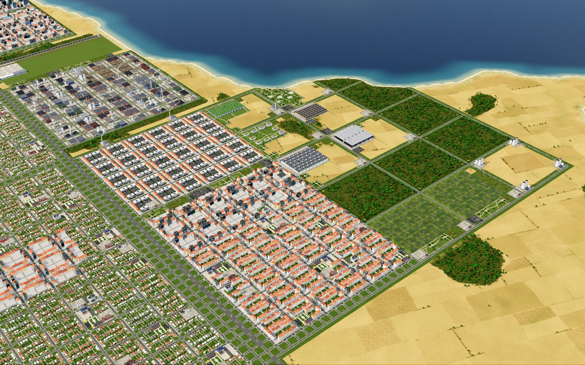
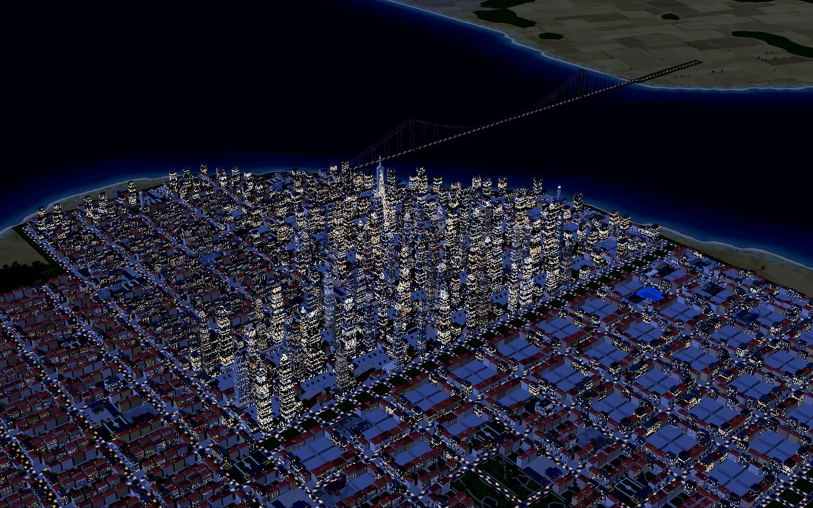

# Silicon City

I've finally built the game I've always wanted to play. It blends my two nerdy interests: urban planning and business technology. Think SimCity, but in Silicon Valley.

It's set on the real land around Menlo Park and the San Francisco Bay. You start with an empty map and grow it into a city: lay roads, zone homes and shops, keep the lights on and the taps running, and keep people happy enough to stay.

Then the tech giants come calling.

Letters land on the mayor's desk from the biggest names in tech. Each wants to build a data centre, a chip factory, a gigafactory or a sprawling campus. Say yes, and you get jobs, investment and tax. You also get:

- power and water demand that can drain your grid
- a hum that knocks value off nearby homes
- campuses that push house prices out of reach
- the odd billionaire threatening to leave if you don't cut his taxes

Closer to home, you can back local start-ups, and watch them get bought or go bust.

It's a very current game about the socio-economic trade-offs of big tech: energy, water, gentrification, and who really pays for growth.

Welcome to Silicon City.

Made in [Godot](https://godotengine.org) (free).

**Status:** a full game in 3D, still being played and tuned.

## What's in it

- **Zones that build themselves:** homes, shops, industry and offices in three densities, growing from Californian ranch houses and townhouses to skyscrapers in a CBD.
- **A town to run:** power and water networks, rubbish, police, fire, schools and hospitals, taxes, loans and happiness. Advisors tell you what's wrong.
- **Traffic:** roads, avenues and motorways. Drivers take the quickest way, and a Traffic view shows where the jams are. You can build bridges across the Bay.
- **Map views:** land value, power, water, services, pollution, traffic, districts and more.
- **The tech layer:**
  - Set up a Tech zone with its own tax rate.
  - Letters arrive from real companies (satire, names only) asking to build data centres, a Gigafactory, campuses, a launch site and a chip factory.
  - Back start-ups, and train tech workers at colleges, a university and a research park.
- **San Francisco's landmarks:** the Painted Ladies, Coit Tower, the Ferry Building, the Palace of Fine Arts, the Transamerica Pyramid, Salesforce Tower, the Golden Gate Bridge and Alcatraz.
- **Example cities** to load from the menu: Village, Town, City and Bay Area. Bay Area is San Francisco and Silicon Valley with about 100,000 people.
- **A built-in guide:** press H.

## Play it

**Download** the game for Mac or Windows from the [Releases page](https://github.com/samdickie/city-sim-creator/releases/latest), unzip it and double-click **Silicon City**. It isn't signed by Apple or Microsoft, so the first time:

- **Mac:** if it says it can't be opened, go to System Settings → Privacy & Security, scroll down and click **Open Anyway**.
- **Windows:** if it says Windows protected your PC, click **More info**, then **Run anyway**.

### Or run it in Godot

1. Install **Godot 4.7** (free) from https://godotengine.org/download.
2. In Godot's Project Manager, choose **Import**, pick this folder's `project.godot`, then **Import & Edit**.
3. Press **Play** (▶, top right) or F5.
4. Pick a difficulty for a new city, or open ☰ → **Example cities** to look around a finished one.

### Controls

Build with the mouse: press, drag to see a preview and the cost, then let go to build.

| Keys | What they do |
| --- | --- |
| 1 | Roads |
| 2 / 3 / 4 | Homes, shops, industry (Tab changes density) |
| 9 | Street grid (drag a box) |
| 5 or B | Bulldoze |
| 6 / 7 | Power, utilities (Tab picks the next building) |
| 8 / - / = | Parks, leisure, transport |
| 0 | Services |
| Z | Paint districts |
| M | Show or hide the Build menu |
| Esc | Cancel a drag |
| Cmd/Ctrl + Z | Undo the last build |
| Space | Pause or play |
| F | Fast |
| O | Next map view |
| C | Services view, one service at a time |
| T | Cars and people on or off |
| H | The guide |
| W A S D, two-finger scroll, middle-drag | Move the camera |
| Q / E, right-drag | Turn and tilt |
| Scroll, pinch | Zoom |
| Cmd/Ctrl + S / L | Save / load |

## The map

The map is the real land of Menlo Park, East Palo Alto and the Bay, from USGS and NOAA height data.

## Credits

- **Heights:** USGS 3DEP and NOAA, via the AWS Terrain Tiles open data set.
- **Textures and sky:** [Poly Haven](https://polyhaven.com) (CC0).
- **Company letters:** satire of public personas. Names only, no logos.

Want to change the game? See [DEVELOPING.md](DEVELOPING.md).
